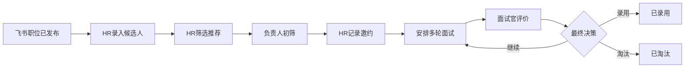

# HRM 招聘协作 PRD V1.0

| 项目 | 内容 |
| --- | --- |
| 产品 | 公司内部 HRM 招聘协作试点 |
| 版本 | V1.0 |
| 试点 | 技术部前端招聘 |
| 状态 | 本仓库首个可运行业务版本 |

## 1. 产品总览

招聘需求申请、审批和职位发布继续在飞书完成，HRM 从职位发布后承接协作。首期解决候选人资料分散、角色责任不清、面试评价缺失和候选人长期未推进问题。

本期包含：招聘工作台、职位与候选人管理、HR 筛选推荐、用人负责人初筛、外部邀约记录、面试安排、面试评价、最终招聘决策和审计时间线。候选人使用合成数据，角色使用本地模拟标签；暂不接入真实账号、飞书、Boss 直聘和外部消息。

## 2. 角色与权限

| 角色 | 允许操作 | 数据边界 |
| --- | --- | --- |
| HR | 录入候选人、筛选、邀约、安排面试、最终决策 | 可见本职位完整联系方式 |
| 用人负责人 | 查看负责职位、提交初筛 | 不可改写 HR 筛选和面试评价 |
| 面试官 | 查看被分配面试、提交评价 | 联系方式脱敏，只看必要资料 |
| 管理员 | 查看职位和活动 | 配置权限不等于默认查看招聘敏感资料 |

## 3. 主流程

状态：`待筛选`、`HR推荐`、`负责人初筛`、`面试中`、`待决策`、`已录用`、`已淘汰`。终态不允许普通角色恢复。每次状态变化写入活动记录。

## 4. 功能验收

1. HR 可录入姓名、11 位手机号、来源和简历摘要；同一职位+手机号重复时拒绝写入。
2. HR 推荐后，用人负责人出现初筛待办；负责人通过后，HR 可记录邀约并安排面试。
3. 面试官只能看到被分配候选人，手机号脱敏；评价包含结论、1-5 分、优点和风险建议。
4. 所有待评价面试完成后，候选人进入待决策；HR 可录用、淘汰或继续面试。
5. 工作台展示当前角色待办、候选人看板和最近活动。
6. 权限不足、缺少必填、重复提交和写入失败不改变业务状态。

## 5. 数据治理与未决边界

本期仅使用合成数据。正式上线前必须补充统一身份认证、组织同步、简历原文存储/保留期、访问审计和导出审批。长期未推进的阈值、正式账号、面试改期/取消、到岗确认和飞书/Boss 同步由后续版本确认。
